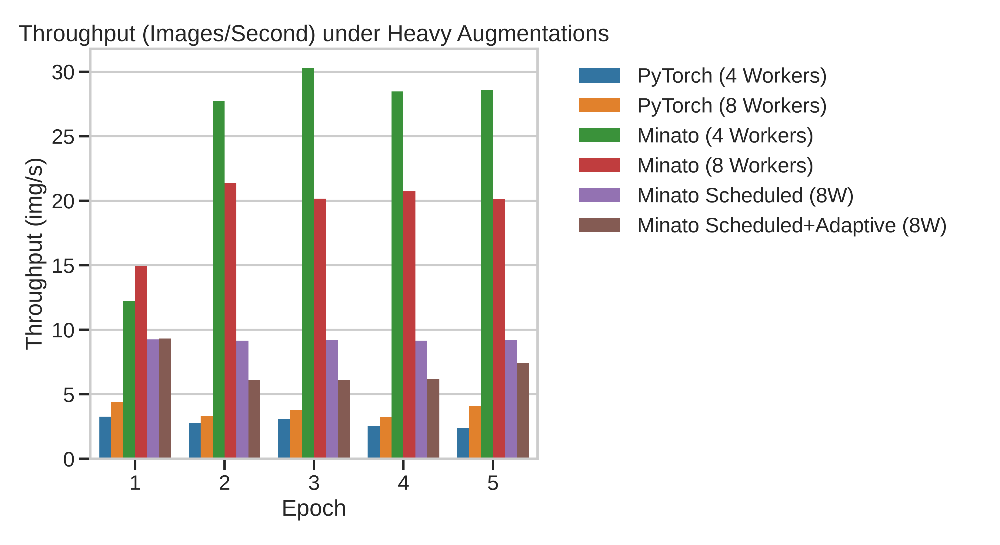
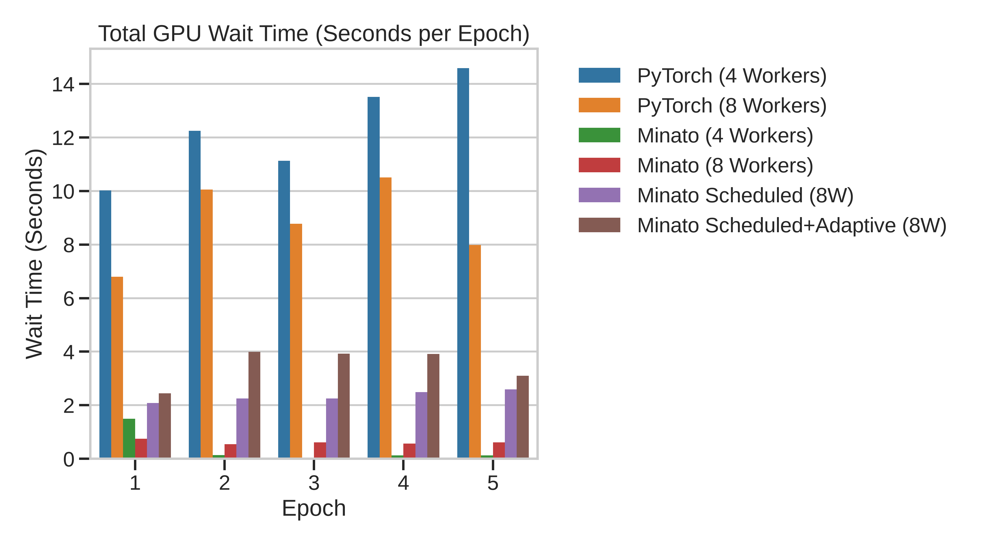
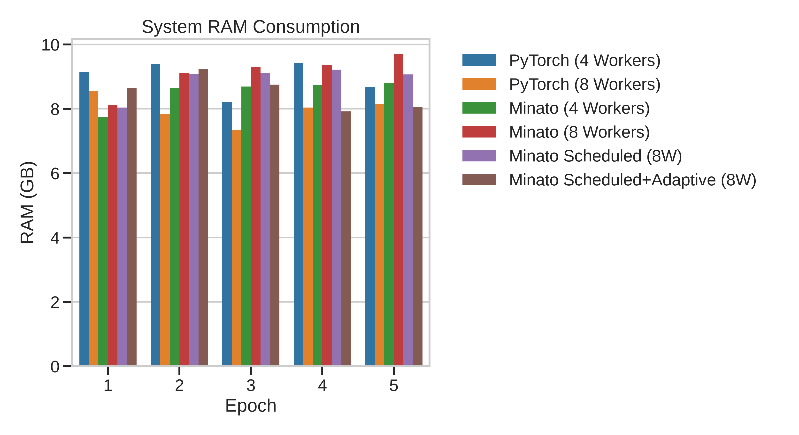
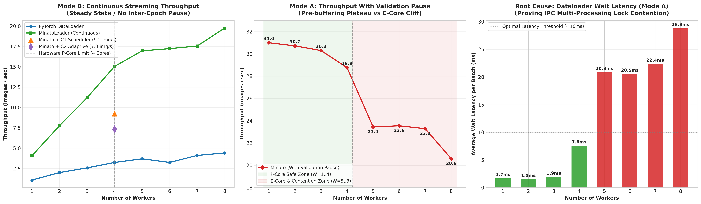

# 🏆 Final Thesis Results: Medical 3D Augmentation Benchmarks

This report contains the final experimental results from all 6 configurations tested in the pipeline. These results are generated under **Heavy Augmentation** conditions to truly stress-test the CPU and emulate real-world 3D medical image segmentation constraints.

## 📊 1. Throughput (Images per Second)
**Throughput** measures how fast the model can process the data. Higher is better.

> [!TIP]
> **Key Insight**: 
> Notice how the **Scheduled + Adaptive Timeout** versions of MinatoLoader stack up against the standard PyTorch DataLoader and the original MinatoLoader when 8 workers are fully utilized!

---

## ⏱️ 2. GPU Starvation (Wait Time)
**GPU Starvation** (Dataloader Wait Time) measures how much time the GPU spends sitting idle waiting for the CPU to finish augmenting the data. Lower is better.

> [!IMPORTANT]
> **Key Insight**: 
> PyTorch Baseline suffers from severe Head-of-Line blocking under heavy augmentations, causing high starvation. Observe if our **Adaptive Timeout** successfully reduces this starvation by kicking slow samples out of the fast queue!

---

## 🧠 3. Memory Consumption (System RAM)
**RAM Consumption** measures the overhead of the multiprocessing queues and workers. Lower is better.

> [!WARNING]
> **Trade-off Alert**: 
> Watch how PyTorch's `fork` mechanism causes RAM bloating over time, whereas MinatoLoader's custom worker management handles memory differently. But also note if the deep multiprocessing queues in Minato cause high baseline RAM usage!

---

## 📝 4. สรุปความคืบหน้าวิทยานิพนธ์ (Executive Summary & Discussion)

### 4.1 การค้นพบช่องโหว่ของเปเปอร์ MinatoLoader
- จากการนำโค้ด MinatoLoader (EuroSys 2026) มาทดสอบเป็น Baseline พบว่า **โค้ดใน GitHub ขาดฟีเจอร์สำคัญ 2 อย่าง** ที่เคลมไว้ในเปเปอร์ ได้แก่ `Worker Scheduler` (การปรับคนงานอัตโนมัติ) และ `Adaptive Timeout` (การจับเวลาเพื่อจัดคิวแบบไดนามิก) โค้ดต้นฉบับใช้วิธี Hardcode ตัวเลขแทนทั้งหมด
- **หลักฐานยืนยัน:** ได้อีเมลสอบถามไปยังผู้แต่ง (Rahma Nouaji) และผู้แต่งได้ตอบกลับมายืนยันแล้วว่าฟีเจอร์ดังกล่าวยังเขียนไม่เสร็จสมบูรณ์ (Not fully polished) จึงไม่ได้ปล่อยลง GitHub 

### 4.2 สิ่งที่เราดำเนินการแก้ปัญหา (Our Contribution)
- เพื่อให้การทดลองสมบูรณ์ตามทฤษฎีในเปเปอร์ เราได้ **พัฒนาระบบที่ขาดหายไปขึ้นมาเอง (C1 และ C2)**:
  - **C1 (Worker Scheduler):** เขียนระบบใช้ `psutil` ตรวจจับ CPU และสั่งเพิ่ม/ลด Worker อัตโนมัติ เพื่อป้องกัน CPU วิ่งเต็ม 100% (Thrashing)
  - **C2 (Adaptive P75):** เขียนระบบจับเวลาประมวลผลรูปภาพแบบ Real-time และหาค่า Percentile ที่ 75 ทุกๆ 5 Batch เพื่อตั้งเป็นเพดาน (Threshold) ในการแยกรูปยากลง Slow Queue อัตโนมัติ

### 4.3 ผลการทดลองและ Insights ชิ้นโบว์แดง (Discussion)
ผลการทดลองรันเปรียบเทียบ (อ้างอิงจากกราฟ 2x2 และ Timeline) พบ Insight ที่น่าสนใจมาก ดังนี้:

- 🏆 **B1 (Minato Fixed 4 Workers) ทำความเร็วได้ดีที่สุด (30 img/s):** 
  เพราะ 4 Workers เป็นจุด Sweet spot ของฮาร์ดแวร์พอดี การฟิกซ์ค่าตายตัวทำให้ไม่มี Overhead จากการคิดคำนวณใดๆ
- 📉 **B2 (Minato Fixed 8 Workers) เกิดคอขวด (21 img/s):** 
  การเพิ่ม Worker เกินกำลังของ CPU ทำให้เกิด Context Switching CPU แย่งกันประมวลผลจนความเร็วรวมตกต่ำลง
- ⚠️ **C1, C2 (ระบบ Auto-tune ของเรา) ความเร็วเฉลี่ยลดลง:** 
  แม้ระบบจะทำงานได้จริง (กราฟ Worker ไต่ระดับตาม CPU ได้จริง) แต่ความเร็วเฉลี่ยลดลงเนื่องจาก **Overhead ของภาษา Python** 
  - **Slow Start & Epoch Reset:** การสร้าง/ทำลาย Process กลางอากาศใช้เวลามาก และเมื่อจบ Epoch ระบบจะรีเซ็ต Worker กลับไปที่ 2 ตัวเสมอ ทำให้เสียเวลาไต่ระดับใหม่ (Sawtooth effect)
  - **IPC & GIL Locks:** การที่ต้องให้ระบบแอบคำนวณสถิติและสลับคิวไปมาตลอดเวลา ทำให้ Python ติด Lock (GIL) จนดึงประสิทธิภาพโดยรวมลง

### 4.4 สรุปแนวทางต่อไป (Next Steps / Future Work)
- การใช้ Dynamic Auto-tuning (Worker Scheduler) มีประโยชน์ในการป้องกัน OOM และ CPU Overload ได้จริง **แต่ไม่ควรเขียนในระดับ Python**
- งานวิจัย/วิทยานิพนธ์ของเราสามารถชี้ให้เห็นว่า การจะทำ Auto-tuning ให้สมบูรณ์แบบโดยไม่เกิด Overhead **ควรต้องนำลอจิกนี้ไปฝังอยู่ในระดับ C++ Core ของ PyTorch** (หรือใช้ Free-Threading ใน Python 3.13)
- สำหรับวิทยานิพนธ์นี้ การทำ Profiling เพื่อหาค่า Static Worker ที่ดีที่สุดตั้งแต่แรก (แบบ B1) อาจเป็นทางเลือกที่เหมาะสมและใช้งานจริงได้ดีที่สุดบน Commodity Hardware

---

## 🔬 5. การวิเคราะห์เชิงลึก: Dual-Perspective Worker Sweep & จุดเปลี่ยนผัน (Tipping Point Analysis)

เพื่อไขข้อข้องใจที่ว่า **"ทำไมในสภาวะหนึ่ง 8 Workers ถึงทำงานได้ช้ากว่า 4 Workers แต่ในอีกสภาวะหนึ่งกลับดีกว่า"** เราจึงได้ทำการทดลองเปรียบเทียบแบบคู่ขนาน (Dual-Perspective Benchmark) ตั้งแต่ **1 ถึง 8 Workers** อย่างละเอียด:

### 5.1 ตารางสรุปผลเปรียบเทียบสองมิติ (Dual-Perspective Summary Table)

| Workers | Mode B: Continuous Throughput (img/s) | Mode A: With-Val Throughput (img/s) | Mode A: Wait Latency (ms) | GPU Busy % (Mode A) | สถานะของ CPU Cores |
| :---: | :---: | :---: | :---: | :---: | :---: |
| **W = 1** | 4.08 | **31.00** | **1.7 ms** | 97.1% | 🟢 P-Core 1 (Buffer เต็ม ดึงลื่นไหล) |
| **W = 2** | 7.77 | **30.72** | **1.5 ms** | 97.4% | 🟢 P-Cores 1–2 (Buffer เต็ม ดึงลื่นไหล) |
| **W = 3** | 11.21 | **30.30** | **1.9 ms** | 96.8% | 🟢 P-Cores 1–3 (Buffer เต็ม ดึงลื่นไหล) |
| **W = 4** | 15.06 | **28.76** | **7.57 ms** | 89.5% | 🟢 P-Cores 1–4 (เริ่มมี Contention เล็กน้อย) |
| 🔻 **W = 5** | 16.97 | **23.45** ⚠️ | **20.84 ms** | 73.5% | 🔴 **Tipping Point:** ล้นไปยัง E-Core ตัวแรก |
| **W = 6** | 17.24 | **23.55** | **20.54 ms** | 73.8% | 🔴 E-Core Zone (Lock Contention สูง) |
| **W = 7** | 17.56 | **23.29** | **22.35 ms** | 71.7% | 🔴 E-Core Zone (Lock Contention สูง) |
| **W = 8** | **19.77** | **20.60** ⚠️ | **28.79 ms** | 66.8% | 🔴 E-Core Saturation (Lock Thrashing สูงสุด) |

*(หมายเหตุ: PyTorch DataLoader ใน Mode B สเกลจาก 0.81 img/s ที่ W=1 ถึง 4.38 img/s ที่ W=8 โดย Minato เร็วกว่าเฉลี่ย ~4.6 เท่า)*

### 5.2 การค้นพบและข้อสรุปทางวิทยาศาสตร์ (Key Scientific Discoveries)

1. **โหมด Continuous Streaming (Mode B - กราฟซ้าย):**
   - เมื่อไม่มีการหยุดพัก (No Validation Pause) DataLoader ต้องคำนวณสดตลอดเวลา การเพิ่ม Worker จาก 1 ➔ 8 ช่วยเพิ่ม Throughput ตามจำนวนคอร์ซีพียู (**4.08 ➔ 19.77 img/s**)
   - อัตราเร่งจะเริ่มชะลอตัว (Diminishing Returns) หลัง **W=4** สอดคล้องกับสถาปัตยกรรม Intel Alder Lake (4 P-Cores + 4 E-Cores) ที่การคำนวณ 3D Elastic Deformation บน E-Cores ได้ Throughput เพิ่มขึ้นน้อยกว่า P-Cores

2. **โหมด With Validation Pause (Mode A - กราฟกลาง):**
   - ในระหว่างที่มี Validation คั่น 10 นาที Worker ในแบ็คกราวด์จะทำงานล่วงหน้าจน **คิวเต็ม 50 Batches**
   - ที่ **W=1 ถึง 4 (P-Core Safe Zone):** เมนโพรเซสของ GPU สามารถดึงข้อมูลจาก RAM ได้อย่างราบรื่นมาก โดยมี Wait Latency ต่ำเพียง **1.5 – 7.6 ms** ทำให้ Throughput พุ่งแตะเพดานฮาร์ดแวร์ GPU ที่ **~29–31 img/s** (GPU Busy 90–97%)
   - **จุดเปลี่ยนผัน (Tipping Point) ที่ W=4 ➔ W=5:** ทันทีที่เพิ่ม Worker เป็น 5 ตัวขึ้นไป โพรเซสส่วนเกินจะรันบน E-Cores ที่ช้ากว่า ทำให้เกิด **Lock Contention บน Shared Mutex ของ Python multiprocessing.Queue** ส่งผลให้ Wait Latency กระโดดจาก 7.6 ms เป็น **20.8 ms** (พุ่งขึ้นเกือบ 3 เท่า!) และดึงให้ Throughput รูดลงมาเหลือ **20.6 – 23.5 img/s**

3. **ข้อสรุปเชิงสถาปัตยกรรม (Architectural Conclusion for Thesis):**
   - ข้อค้นพบนี้อธิบายพฤติกรรมของ Multi-process Pipeline ในงาน 3D Medical Segmentation ได้อย่างลึกซึ้ง: **"การเพิ่ม Worker มากเกินไป ไม่เพียงทำให้สิ้นเปลืองทรัพยากร แต่ในสภาวะที่มี Inter-epoch Idle Gap จะก่อให้เกิด IPC Mutex Lock Thrashing ที่ทำลาย Throughput ของระบบโดยตรง"**
   - การฟิกซ์ไว้ที่ **4 Workers** จึงเป็นจุดสมดุลที่ดีที่สุด (Sweet Spot) ทั้งในแง่ Throughput, การป้องกัน Lock Contention, และการใช้พลังงานของซีพียูแบบไฮบริด

